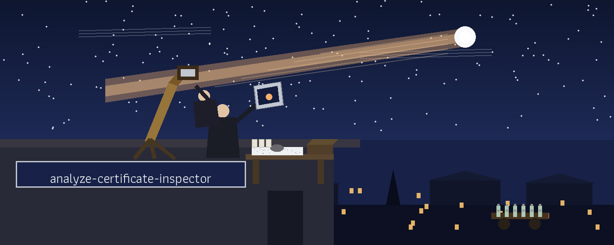

# analyze-certificate-inspector

Inspects SSL/TLS certificates and shows their subject, issuer, validity dates, version, and serial number, with a check on whether the certificate has expired or is close to expiring. - Focused on Data analysis and reporting

## Install
`git clone https://github.com/ShadowGuardAI/analyze-certificate-inspector`

## Usage
`./analyze-certificate-inspector [params]`

## Parameters
- `-h`: Show help message and exit

> **Plate envelope, Has Its Time Run Out:** the tool checks whether the certificate has expired or is close to expiring, the one judgement in this document that carries a date with consequences.
- `-p`: No description provided

> **Plate envelope, No Description on the Envelope:** `-p` arrives with no description provided, and the blank is left showing rather than filled with an invented duty.
- `-v`: Enable verbose logging.
- `-o`: Output the certificate details to a CSV file.

## License
Copyright (c) ShadowGuardAI
